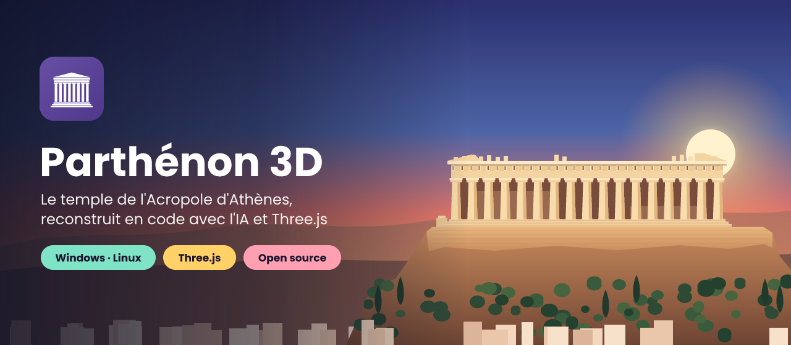
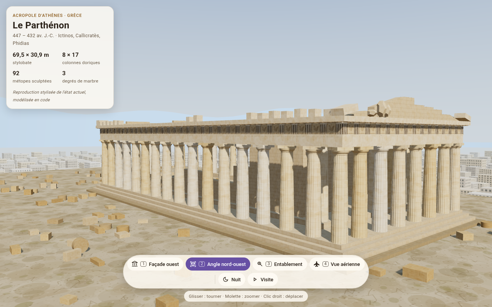
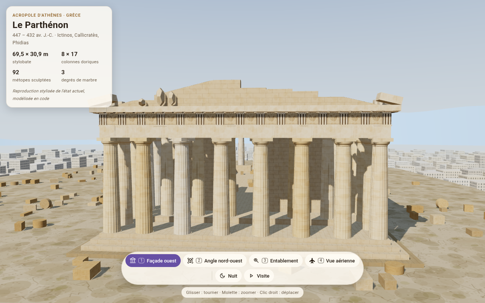
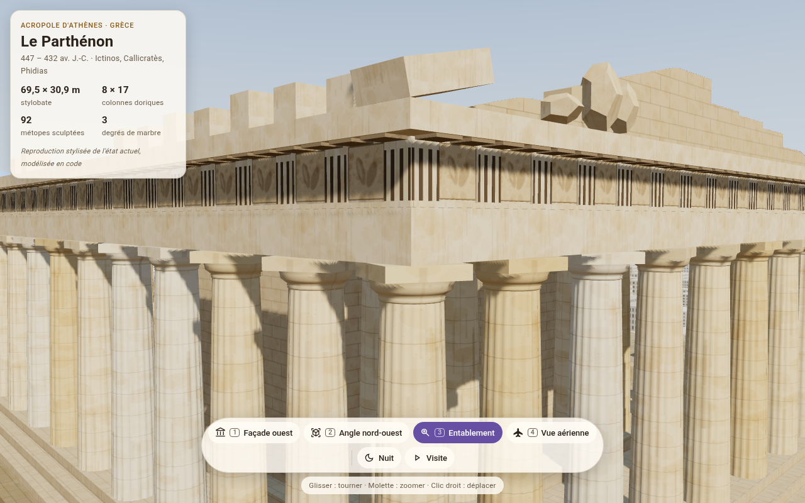
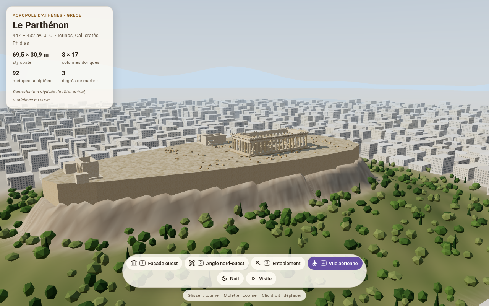
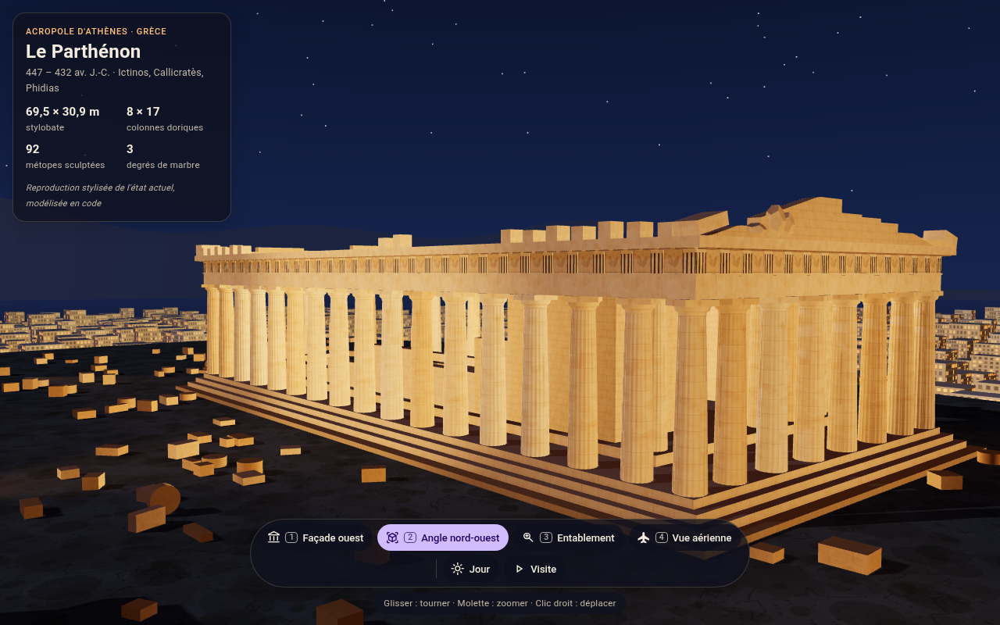

<p align="center">
  
</p>

<p align="center">
  <a href="https://github.com/JulesROGUE/parthenon-3d/releases/latest"></a>
  
  
  
</p>

<p align="center"><b>Le Parthénon de l'Acropole d'Athènes, reconstruit en 3D uniquement avec du code : aucun modèle 3D, aucune texture téléchargée.</b></p>

<p align="center"><a href="https://github.com/JulesROGUE/parthenon-3d/releases/latest"><b>⬇️ Télécharger pour Windows ou Linux</b></a></p>

---

## L'idée

Le défi : reproduire un monument que tout le monde reconnaît au premier coup d'œil **uniquement en code**, avec l'aide de l'IA. Pas de fichier `.glb`, pas de photo plaquée : chaque colonne, chaque triglyphe et chaque bloc est une géométrie Three.js générée au lancement, et les « textures » (marbre patiné, joints des tambours, métopes érodées, frise ionique) sont dessinées dans des `canvas`.

Pour rester fidèle, le modèle a été **calé sur des images de référence réelles** (Wikimedia Commons) : rapports hauteur/largeur, nombre de colonnes et de métopes, profil ruiné des frontons, couleurs du marbre, contexte du rocher. Les dimensions principales viennent des sources citées plus bas (1 unité = 1 m).

Le Parthénon est représenté **dans son état actuel**, stylisé : sans toit, frontons ruinés, cella arasée, blocs rangés autour du temple.

## Aperçu

<p align="center">
  
  
</p>
<p align="center">
  
  
</p>
<p align="center">
  
</p>

## Références visuelles

Ces images (Wikimedia Commons) ont servi uniquement à mesurer et à comparer. **Elles ne sont pas redistribuées** dans ce dépôt ni dans l'application.

| Image de référence | Ce qu'on en a tiré |
| --- | --- |
| [Parthenon - facade ouest.jpg](https://commons.wikimedia.org/wiki/File:Parthenon_-_facade_ouest.jpg) | 8 colonnes, contraction des entrecolonnements d'angle, rapport colonne / entablement (≈ 3), profil en gradins du fronton ouest, porche intérieur et grande porte |
| [Parthenon.jpg](https://commons.wikimedia.org/wiki/File:Parthenon.jpg) | 20 cannelures, joints des tambours, patine dorée, colonnes restaurées plus blanches |
| [Parthenon east side Acropolis Athens, Greece.jpg](https://commons.wikimedia.org/wiki/File:Parthenon_east_side_Acropolis_Athens,_Greece.jpg) | 17 colonnes par côté, blocs isolés au-dessus des corniches, teinte du marbre et du ciel |
| [The Parthenon from the northeast (13896193092).jpg](https://commons.wikimedia.org/wiki/File:The_Parthenon_from_the_northeast.,_Acropolis_of_Athens_%2813896193092%29.jpg) | Fronton est (amorce du rampant au sud, bloc d'angle au nord), colonnade nord restaurée, murs bas de la cella |
| [Parthenon on Acropolis in Athens.jpg](https://commons.wikimedia.org/wiki/File:Parthenon_on_Acropolis_in_Athens.jpg) | Angle vu d'en bas : blocs de corniche, rampant d'angle, ombres des mutules |
| [Acropolis of Athens 01361.JPG](https://commons.wikimedia.org/wiki/File:Acropolis_of_Athens_01361.JPG) | Triglyphes en saillie, métopes, taenia, mutules, abaque et échine des chapiteaux |
| [The Acropolis of Athens on June 1, 2021.jpg](https://commons.wikimedia.org/wiki/File:The_Acropolis_of_Athens_on_June_1,_2021.jpg) | Contexte : plateau allongé ceint de murs, falaises, pentes boisées, ville blanche, montagnes |
| [Élévation et plan du Parthénon (Barthélemy, 1832)](https://commons.wikimedia.org/wiki/File:El%C3%A9vation_de_la_Fa%C3%A7ade_ant%C3%A9rieure_du_Parth%C3%A9non,_Plan_du_Parth%C3%A9non_-_Jean-Jacques_Barth%C3%A9lemy_-_1832.jpg) | Plan mis à l'échelle : bloc de la cella, porches hexastyles, mur de refend ; pente du fronton |

## Ce qui est modélisé

| Élément | Construction | Dimensions retenues |
| --- | --- | --- |
| Crépis | Assise de réglage + 3 degrés (`BoxGeometry` fusionnées) | Stylobate 69,5 × 30,88 m ; degrés de 0,51 m |
| Péristyle | `InstancedMesh` de 46 colonnes (8 × 17) : fût `CylinderGeometry` déformé (20 cannelures, galbe), échine `LatheGeometry`, abaque | Hauteur 10,43 m ; Ø 1,90 m en pied, 1,48 m au sommet ; entrecolonnement ≈ 4,30 m, ≈ 3,70 m aux angles |
| Entablement | Architrave, taenia, frise et geison fusionnés avec `mergeGeometries` | 1,35 + 1,35 + 0,60 m ; 92 métopes (14 par façade, 32 par côté) entre les triglyphes ; mutules sous la corniche |
| Frontons | `ExtrudeGeometry` d'une `Shape` au profil ruiné relevé sur les photos + amorces des rampants | Tympan de 28,55 m pour 3,45 m au faîte (pente ≈ 13,6°) |
| Cella | Murs, porte monumentale, plate-forme, poutres du plafond du péristyle | Bloc ≈ 49,6 × 20,8 m ; porte 4,9 × 9,6 m ; porches à 6 colonnes |
| Frise ionique | `CanvasTexture` (procession stylisée) sur le porche ouest | 1 m de haut |
| Textures | Marbre patiné, joints de tambours, métopes érodées, sol calcaire : tout en `canvas` | — |
| Acropole | Contour extrudé (murs), terrain par fonction de hauteur, ~900 arbres et des milliers d'immeubles en `InstancedMesh` | Plateau ≈ 300 × 130 m, à 62 m au-dessus de la ville |
| Contexte | Érechthéion et Propylées en volumes simplifiés | — |
| Lumière | Soleil avec ombres (shadow map 2048), hémisphère, ciel en dégradé, brouillard ; la nuit : projecteurs chauds, étoiles, fenêtres éclairées | — |

Le rendu se fait **à la demande** (aucune boucle d'animation permanente) : l'image n'est recalculée que lorsqu'on bouge la caméra, change de vue ou lance la visite.

## Commandes

| Action | Souris / clavier |
| --- | --- |
| Tourner autour du temple | Glisser (clic gauche) |
| Zoomer | Molette |
| Se déplacer | Clic droit + glisser |
| Façade ouest / Angle nord-ouest / Entablement / Vue aérienne | Boutons du bas ou touches `1` `2` `3` `4` |
| Jour / nuit | Bouton « Nuit » / « Jour » ou touche `N` |
| Visite guidée (tour lent) | Bouton « Visite » (s'arrête dès qu'on touche la souris) |

## Installation

Téléchargez la dernière version sur la page [Releases](https://github.com/JulesROGUE/parthenon-3d/releases/latest).

- **Windows** : l'exécutable portable (fichier se terminant par `-portable.exe`). Aucune installation : double-cliquez pour lancer.
  > L'exécutable n'est pas signé : Windows SmartScreen peut afficher un avertissement. Cliquez sur « Informations complémentaires » puis « Exécuter quand même ».
- **Linux** :
  - `.AppImage` : `chmod +x Parthenon*.AppImage` puis lancez-le ;
  - `.deb` (Debian, Ubuntu…) : `sudo apt install ./Parthenon*.deb`.

## Développement

```bash
npm install
npm start        # compile puis lance l'application Electron
npm run dist     # crée les paquets (exécutable portable Windows, AppImage, .deb)
```

| Outil | Version |
| --- | --- |
| Three.js | 0.187.0 |
| Electron | 45.2.1 |
| React | 19.3.1 |
| Vite | 8.3.5 |
| electron-builder | 26.18.1 |

Organisation du code :

```
src/
├── App.jsx            # monte la scène et la surcouche
├── viewpoints.js      # points de vue nommés (#facade, #angle, #detail, #aerien)
├── scene/             # renderer, caméra, lumières, ciel, terrain, textures
├── model/             # dimensions (avec sources), crépis, colonnes, entablement, frontons, cella…
└── ui/                # carte d'information et barre de commandes
```

Les releases Windows et Linux sont compilées par GitHub Actions à chaque tag `v*`.

## Sources

- [Parthenon — Wikipédia (en)](https://en.wikipedia.org/wiki/Parthenon) : 69,5 × 30,9 m, octastyle périptère, 8 × 17 colonnes, 92 métopes, courbure du stylobate (10,3 cm sur 70 m), explosion de 1687, restaurations.
- [Parthenon — Encyclopædia Britannica](https://www.britannica.com/topic/Parthenon) : 30,89 × 69,54 m sur le degré supérieur, soubassement à trois degrés, architectes Ictinos et Callicratès sous la supervision de Phidias, 447 – 432 av. J.-C.
- [Parthenon — World History Encyclopedia](https://www.worldhistory.org/parthenon/) : 30,88 × 69,5 m, frontons de 28,55 m pour 3,45 m, métopes d'environ 1,2 × 1,25 m, Acropole d'environ 300 × 150 m.
- [Parthenon — Structurae](https://structurae.net/en/structures/parthenon) : 30,88 × 69,51 m, dates de construction.

## Licence

Code sous licence [MIT](LICENSE) © Jules ROGUE. La police Roboto est distribuée sous licence SIL Open Font License.

Ce projet est une **reproduction stylisée et non officielle**, réalisée avec l'aide de l'IA à des fins d'apprentissage. Il n'a aucun lien avec le site archéologique, le ministère grec de la Culture ou tout autre gestionnaire du monument.
